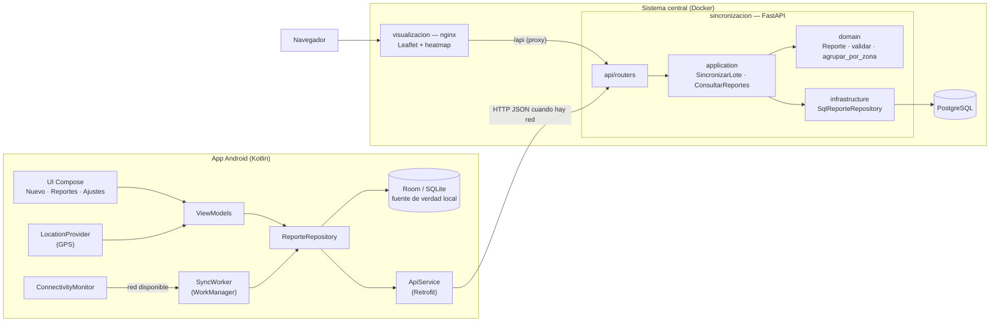
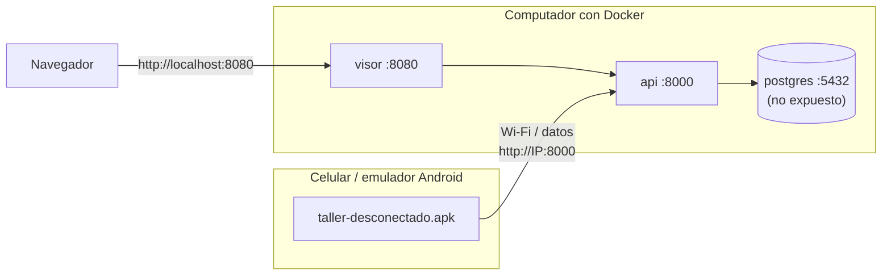
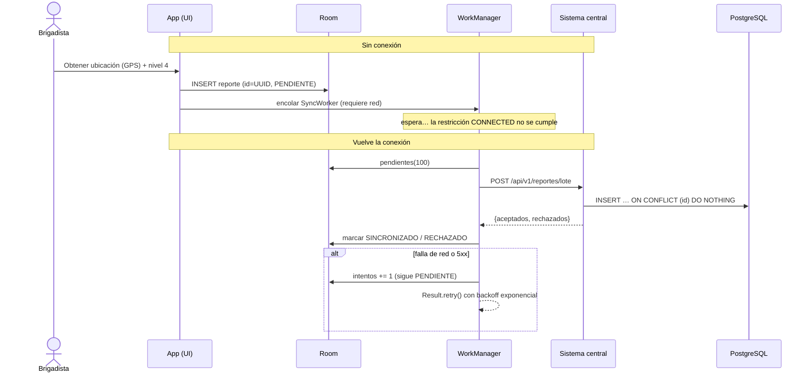
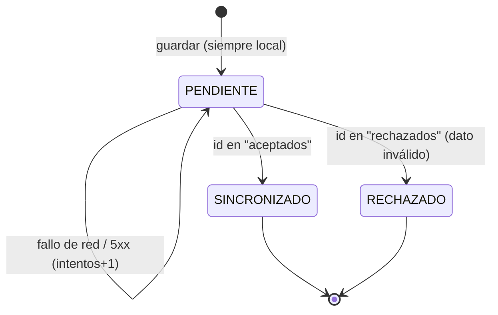

# Diseño — Taller Desconectado

Arquitectura de Software · Pontificia Universidad Javeriana

## 1. Problema y requisitos

Durante un desastre, las brigadas de campo necesitan registrar **dónde** está cada sitio afectado
y **qué tan grave** es, aunque no haya cobertura celular. Esa información debe llegar a un
**sistema central** que la consolide y la muestre como **mapa de calor** para priorizar la atención.

| # | Requisito | Cómo se cumple |
|---|---|---|
| RF1 | Capturar latitud y longitud del sitio | GPS del dispositivo (`LocationManager`, no necesita internet) o ingreso manual |
| RF2 | Capturar nivel de afectación 1–5 | Selector de 5 niveles, validado en la app, en la API y en la base de datos |
| RF3 | Funcionar sin conexión | Room (SQLite) es la fuente de verdad local; guardar nunca depende de la red |
| RF4 | Sincronizar al recuperar la conexión | WorkManager con restricción `CONNECTED` + envío por lotes idempotente |
| RF5 | Mapa de calor de los desastres | Visor web Leaflet + `leaflet.heat`, ponderado por nivel |
| RF6 | Identificar las regiones más afectadas | Agregación por cuadrícula (`/api/v1/zonas`) con ranking por afectación |

### Atributos de calidad (drivers)

| Atributo | Escenario | Táctica |
|---|---|---|
| **Disponibilidad (offline)** | Sin red, el brigadista guarda un reporte → se guarda en < 1 s y queda visible como *Pendiente* | Persistencia local primero (*offline-first*), sin llamadas de red en la ruta de captura |
| **Confiabilidad / no pérdida de datos** | La app se cierra o el teléfono se reinicia con reportes pendientes → se envían al volver la red | Cola persistente en SQLite + WorkManager (sobrevive a reinicios); trabajo periódico de respaldo cada 15 min |
| **Consistencia eventual / idempotencia** | Se pierde la respuesta del servidor y la app reenvía el lote → el servidor no duplica | UUID generado en el dispositivo como clave primaria; `INSERT … ON CONFLICT DO NOTHING`; los duplicados se responden como *aceptados* |
| **Tolerancia a fallas parciales** | Un reporte del lote es inválido → el resto se guarda | Validación por reporte; respuesta `aceptados` / `rechazados`; los rechazados no se reintentan |
| **Eficiencia de red** | Red intermitente y lenta → minimizar peticiones | Envío por lotes de 100; backoff exponencial ante fallos |
| **Usabilidad** | El usuario necesita saber si sus datos ya llegaron | Banner *En línea / Sin conexión*, contador de pendientes y estado por reporte |

## 2. Vista de componentes



**Estilos y patrones utilizados**

- **Cliente–servidor con sincronización *store-and-forward*.** La app trabaja contra su base local
  y reenvía al servidor cuando puede.
- **App móvil en MVVM + Repository.** El repositorio oculta si los datos vienen de Room o de la red.
- **Sistema central en capas / hexagonal** (`api → application → domain`, con puertos y adaptadores),
  igual que en el Taller 1. El dominio (reglas del nivel 1–5 y agregación por zonas) no depende de
  FastAPI ni de SQLAlchemy.
- **Patrón *Outbox* en el cliente.** Cada fila de Room lleva su `estadoSync`, así la tabla de
  reportes es también la cola de salida.

## 3. Vista de despliegue



Desde el emulador, el host se alcanza en `10.0.2.2`. Un celular físico debe estar en la misma red
que el computador y apuntar a la IP de este, que se configura en *Ajustes* dentro de la app.

## 4. Vista dinámica: captura sin conexión y sincronización



### Estados de un reporte en el dispositivo



## 5. Modelo de datos

| Campo | Tipo | Origen | Regla |
|---|---|---|---|
| `id` | UUID | dispositivo | Clave primaria y de idempotencia |
| `latitud` | double | GPS / manual | −90 … 90 |
| `longitud` | double | GPS / manual | −180 … 180 |
| `nivel` | smallint | brigadista | 1 … 5 (CHECK en BD) |
| `evento` | texto ≤ 120 | brigadista | opcional; agrupa reportes de un mismo desastre |
| `descripcion` | texto ≤ 500 | brigadista | opcional |
| `precision_m` | double | GPS | opcional |
| `dispositivo_id` | texto | dispositivo | trazabilidad |
| `capturado_en` | timestamptz | dispositivo | no más de 24 h en el futuro |
| `recibido_en` | timestamptz | servidor | momento de la sincronización |

En el dispositivo se agregan `estadoSync`, `intentos`, `ultimoError` y `sincronizadoEn`.

## 6. Contrato de la API

| Método | Ruta | Uso |
|---|---|---|
| `POST` | `/api/v1/reportes/lote` | Sincronización desde la app (máx. 500 por lote; 413 si se excede) |
| `GET` | `/api/v1/reportes` | Listado con filtros `evento`, `nivel_min`, `desde`, `hasta` |
| `GET` | `/api/v1/heatmap` | `[[lat, lon, intensidad]]` con intensidad = nivel / 5 |
| `GET` | `/api/v1/zonas?celda=0.05&top=10` | Regiones más afectadas (celdas de la cuadrícula) |
| `GET` | `/api/v1/eventos` | Eventos con su número de reportes |
| `GET` | `/health`, `/health/ready` | Liveness y readiness (con la BD) |

La documentación interactiva (OpenAPI) está en `http://localhost:8000/docs`.

Ejemplo de respuesta de un lote:

```json
{
  "aceptados": ["5b0e…", "a91c…"],
  "nuevos": 1,
  "duplicados": 1,
  "rechazados": [{ "id": "77d2…", "motivo": "nivel de afectación debe estar entre 1 y 5" }]
}
```

**Afectación de una zona** = suma de los niveles de sus reportes. Combina la cantidad de sitios y su
gravedad: una zona con muchos sitios graves queda por encima de una con un solo sitio crítico. El
ranking desempata por nivel máximo y luego por promedio.

## 7. Decisiones de arquitectura (ADR)

**ADR-1 · Offline-first con Room como fuente de verdad.**
La UI nunca espera a la red: lee y escribe solo en SQLite, y la sincronización es un proceso aparte.
*Alternativa descartada:* llamar a la API y guardar en caché solo si falla. Así la captura queda
acoplada a la red y aparecen dos caminos de código.

**ADR-2 · UUID generado en el cliente como clave de idempotencia.**
Permite crear registros sin coordinarse con el servidor y reenviar sin miedo a duplicar.
*Alternativa descartada:* un id autoincremental del servidor. Exige un ida y vuelta por reporte y
genera duplicados cuando se pierde una respuesta.

**ADR-3 · WorkManager para la sincronización en segundo plano.**
Respeta las restricciones de batería de Android, persiste la cola de trabajos, se ejecuta al cumplirse
la restricción de red y ofrece backoff. *Alternativa descartada:* un `Service` propio o sondeo
desde la UI, que el sistema puede detener y que no sobreviven a un reinicio. Como complemento, el
botón *Sincronizar* invoca el repositorio directamente. Así también funciona en redes locales sin
salida a internet (Android no las marca como "validadas").

**ADR-4 · Sincronización *push* por lotes, unidireccional.**
Los reportes los produce solo el campo, así que no hay conflictos de edición y basta con enviar.
Agrupar en lotes reduce las peticiones sobre redes intermitentes. La respuesta por reporte
(`aceptados` / `rechazados`) evita que un dato malo bloquee la cola.

**ADR-5 · Mapa de calor generado en el cliente (Leaflet.heat) a partir de puntos ponderados.**
Con el volumen esperado (miles de puntos) el navegador lo pinta sin problema y los filtros responden
al instante. *Alternativa descartada:* generar teselas en el servidor (PostGIS + tile server), que
tiene sentido para millones de puntos pero añade mucha infraestructura. La agregación por zonas sí
se hace en el servidor, porque es una regla del dominio.

**ADR-6 · La ubicación se obtiene con `LocationManager` y no con Fused Location (Play Services).**
El GPS funciona sin datos móviles y la app no depende de Google Play Services.

## 8. Verificación

- `sincronizacion/tests`: 15 pruebas (validación 1–5, idempotencia, lote mixto, lote demasiado
  grande, heatmap, zonas, filtros).
- `app-android/app/src/test`: pruebas del repositorio offline (sin red → pendientes → sincronizados,
  lotes múltiples, rechazados no reintentados) y de validación.
- Prueba manual end-to-end: ver el `README.md`.
